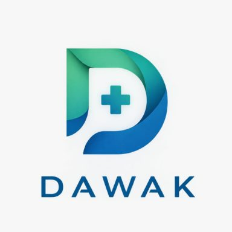
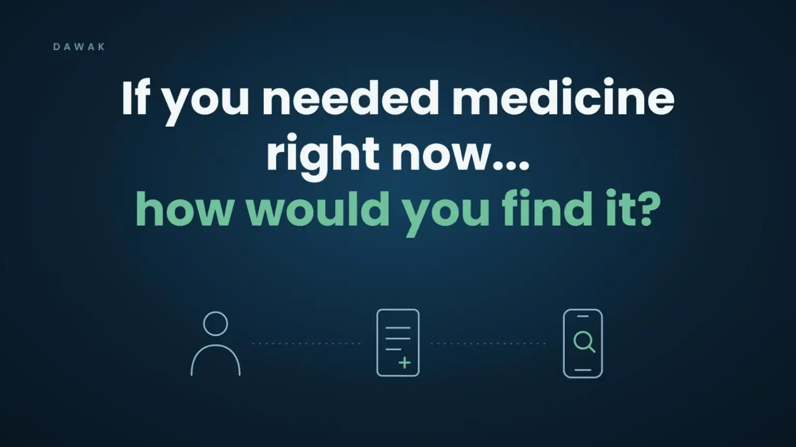
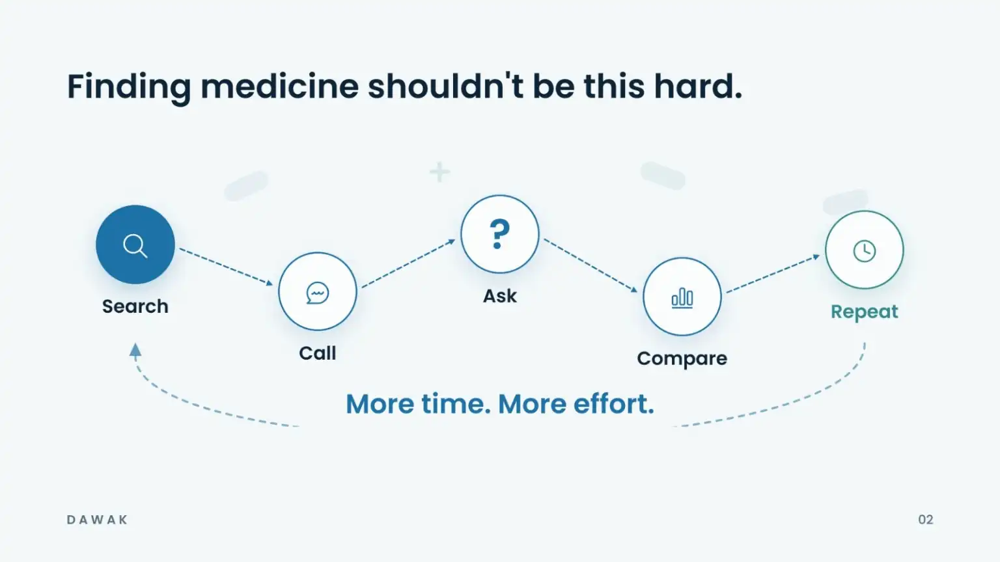
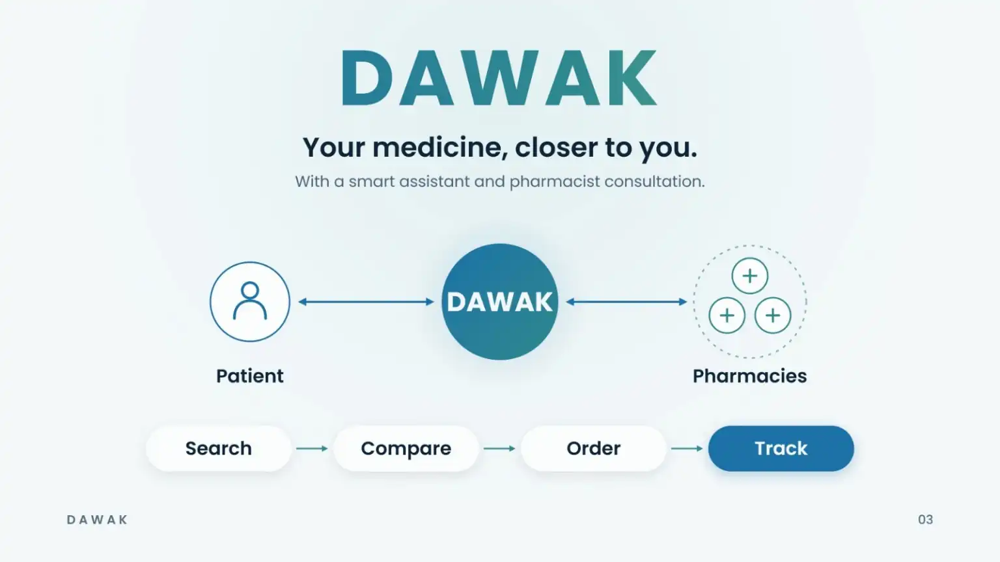
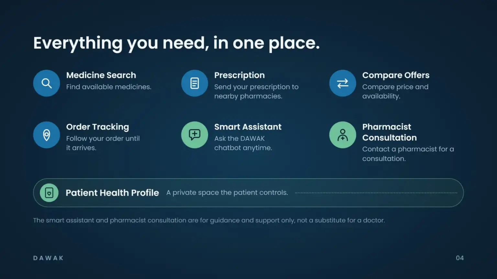
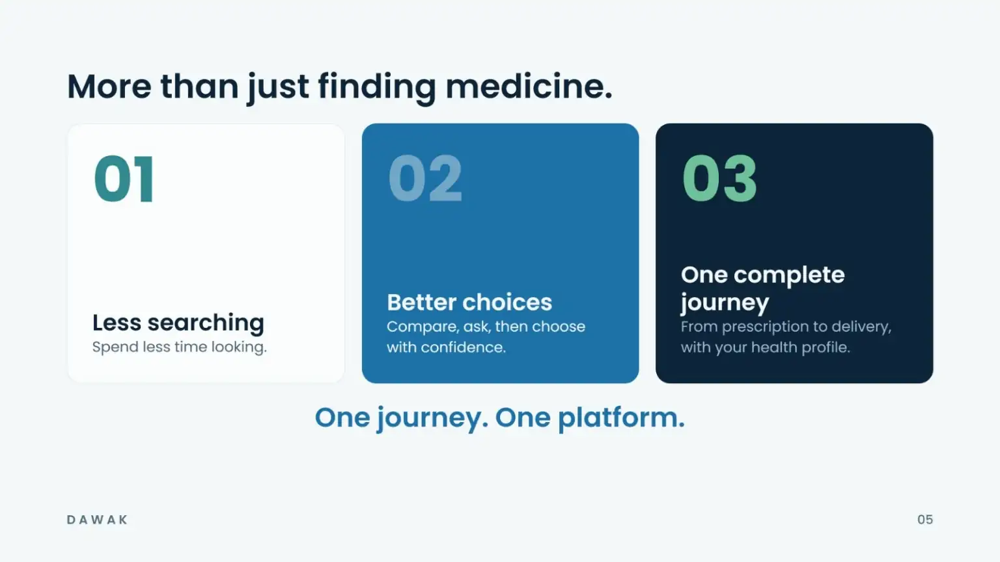
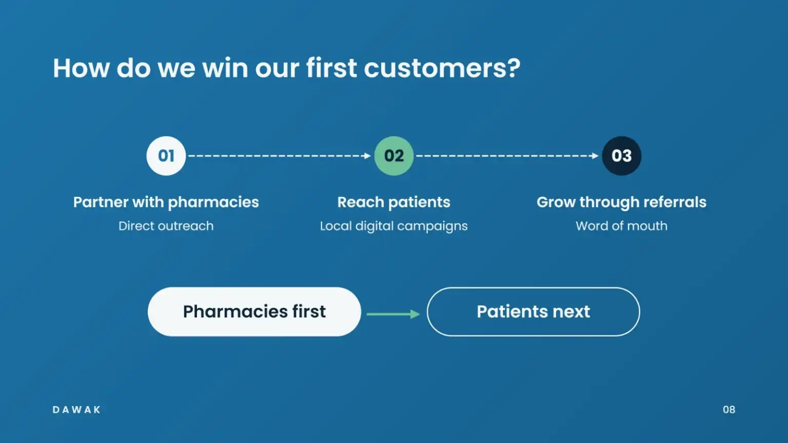

# DAWAK | Pharmacy & Admin Web

### Your medicine, closer to you.

**A modern pharmacy management and administration workspace for the DAWAK healthcare platform.**

[**Live Web App**](https://daway-frontend.vercel.app/) · [**Laravel Backend**](https://github.com/daway-app/daway-backend) · [**API Contract Map**](docs/API-CONTRACT-MAP.md) · [**Contributors**](https://github.com/daway-app/daway-Frontend/graphs/contributors)

[Overview](#overview) · [Features](#features) · [Architecture](#architecture) · [Getting Started](#getting-started) · [Configuration](#configuration) · [Testing](#testing--quality) · [Deployment](#deployment)

> **Repository scope:** This repository is the **React + TypeScript web frontend** for pharmacies and administrators. The Laravel REST API lives in a [separate backend repository](https://github.com/daway-app/daway-backend); the patient-facing mobile app is maintained separately. This README describes the web implementation, not the mobile application's source code.
>
> **About the visuals:** The images below are DAWAK presentation/concept slides provided by the team. They illustrate the product's vision, **not screenshots of the current React interface** or proof that every depicted product feature is available in this web app.

---

## Overview

DAWAK (دواك) connects the medicine-search experience with pharmacy operations. The patient journey involves discovering a medicine, exploring availability, coordinating with pharmacies, and tracking requests or orders. The web frontend supports the **pharmacy and admin side** of the platform: managing inventory, requests, orders, accounting, and administration.

The application is an Arabic-first, right-to-left single-page application (SPA), with English-language support. It consumes the Laravel API over HTTP rather than accessing the database directly.

### The problem

Finding medicines can mean repeated searching, calling pharmacies, and comparing incomplete information.

### The DAWAK approach

A connected platform can reduce coordination overhead for both patients and pharmacies.

## Features

### Pharmacy workspace

| Area | What the React web app provides |
| --- | --- |
| **Dashboard** | Pharmacy summaries and operational overview. |
| **Medicines & inventory** | Medicine management, search, stock availability, and inventory updates. |
| **Bulk inventory import** | Import preview and decision workflows for pharmacy inventory. |
| **Alternatives** | View and manage medicine alternatives. |
| **Inquiries & chat** | Handle incoming patient inquiries and their conversations. |
| **Ratings** | View pharmacy rating information. |
| **Orders** | View orders and order details. |
| **Accounting** | Overview, sales, point-of-sale workflow, invoices, refunds, cash activity, debts, and settlement views. |
| **Pharmacy profile** | View and update pharmacy details, complete profile details, and manage password changes. |

### Admin workspace

The admin section has its own guarded layout and pages for:

- Dashboard, pharmacies, medicines, medicine requests, categories, and users.
- Logs, platform settings, and delivery pricing.
- Payment banks, payment reviews, payment problems, and platform settlements.
- Account-closure review, admin profile, and password management.

Actual permissions and data operations are enforced by the backend. Page visibility alone is not authorization.

### Product capabilities at a glance

> The diagram above presents the **wider DAWAK platform**, including patient/mobile experiences. It is not a claim that the web dashboard implements every patient-facing feature.

### Why a connected platform?

## Architecture

The web app uses **React 19, TypeScript, React Router 7, TanStack Query 5, and Vite 6**. Each route loads its corresponding UI; application-specific API clients communicate with the Laravel backend.

~~~mermaid
flowchart TD
    User[Pharmacy / Admin Browser] --> SPA[React + TypeScript SPA]
    SPA --> Router[React Router]
    Router --> Pharmacy[Pharmacy Pages]
    Router --> Admin[Admin Pages]
    SPA --> Context[Auth and Language Providers]
    SPA --> Query[TanStack Query Cache]
    Pharmacy --> Client[Typed API Client]
    Admin --> Client
    Context --> Client
    Query --> Client
    Client -->|HTTPS / JSON| API[Laravel REST API]
    API --> DB[(Backend-managed database)]
~~~

### Architecture notes

- **Separate web sessions:** pharmacy and admin authentication use separate frontend providers and token storage; guards protect their respective route trees.
- **Shared HTTP layer:** API requests set `Accept: application/json` and attach an authorized Bearer token when required. The client supports timeout handling, API error normalization, and a single-flight refresh path.
- **Lazy route loading:** feature pages are loaded on demand.
- **Performance:** TanStack Query helps manage fetched data. The point-of-sale route uses an explicit keep-alive outlet so its in-progress cart does not disappear during normal route navigation.
- **Arabic and English:** language state controls text direction and presentation.
- **PWA support:** the production bundle registers a service worker and includes a web app manifest. Do not assume every workflow works offline; verify it independently.

### Main source directories

~~~text
src/
├── api/           # HTTP client, API modules, and query client
├── app/           # Root providers and application entry
├── auth/          # Pharmacy/admin session state and guards
├── components/    # Shared interface components
├── config/        # Runtime environment configuration
├── features/
│   ├── pharmacy/  # Dashboard, inventory, accounting, orders, ...
│   ├── admin/     # Administration screens and forms
│   └── auth/      # Login, registration, and password screens
├── layouts/       # App shell, admin shell, keep-alive route
├── lib/           # Shared utilities and language support
├── routes/        # Routes, paths, guards and error boundaries
└── styles/        # Design tokens, layouts and page styles

public/            # Static images, fonts, manifest and service worker
docs/              # API contract map and supporting documentation
tools/             # CSS maintenance checks
.github/workflows/ # CI and maintenance workflows
~~~

## Technology Stack

| Layer | Technology |
| --- | --- |
| UI | React 19 |
| Language | TypeScript 5.7 |
| Bundler / development | Vite 6 |
| Routing | React Router 7 |
| Server-state management | TanStack Query 5 |
| Styling | CSS, design tokens, Tajawal fonts, RTL/LTR support |
| Maps | Leaflet (where used by the interface) |
| Testing | Vitest |
| Code quality | ESLint, TypeScript, CSS checks |
| Hosting | Vercel |
| Server API | Laravel (separate repository) |

See [`package.json`](package.json) for the exact dependency versions and scripts.

## Getting Started

### Requirements

- Node.js 22 is used in the project's [CI workflow](.github/workflows/frontend-ci.yml).
- npm (lockfile included).
- A reachable DAWAK Laravel API with suitable test accounts for protected views.

### 1. Clone and install

~~~bash
git clone https://github.com/daway-app/daway-Frontend.git
cd daway-Frontend
npm ci
~~~

### 2. Configure the API

Copy the example to a local-only configuration file:

~~~bash
cp .env.example .env.local
~~~

On Windows Command Prompt:

~~~cmd
copy .env.example .env.local
~~~

For a locally running backend:

~~~dotenv
VITE_API_BASE_URL=http://127.0.0.1:8000
VITE_API_TIMEOUT_MS=60000
VITE_API_DOWNLOAD_TIMEOUT_MS=180000
~~~

For development against the hosted API, replace `VITE_API_BASE_URL` with the approved backend origin. The app makes requests to the backend directly; the Vite dev server does **not** proxy the API.

### 3. Start the dev server

~~~bash
npm run dev
~~~

Open [http://localhost:5173](http://localhost:5173) (the port configured in `vite.config.ts`).

### 4. Build and preview

~~~bash
npm run build
npm run preview
~~~

A successful build does not establish that authenticated workflows or responsive layouts have been visually tested. Use appropriate pharmacy/admin test accounts when checking those pages.

## Configuration

These are the frontend variables documented by [`.env.example`](.env.example):

| Variable | Purpose |
| --- | --- |
| `VITE_API_BASE_URL` | Origin of the Laravel API (without assuming a proxy). |
| `VITE_API_TIMEOUT_MS` | Timeout budget for ordinary JSON requests; example: `60000` ms. |
| `VITE_API_DOWNLOAD_TIMEOUT_MS` | Longer budget for downloaded workbooks and files; example: `180000` ms. |

**Security:** variables prefixed `VITE_` are bundled into browser-side code. Never place passwords, private API keys, database credentials, or server secrets in them. Keep `.env.local` uncommitted.

### Authentication

The current app includes one login experience for pharmacy and admin roles. The pharmacy and admin areas have independent session providers; the web app uses the Laravel backend for authentication and authorization.

For the **current** backend auth endpoints and requirements, consult the [backend's route definitions](https://github.com/daway-app/daway-backend/blob/develop/routes/api.php). Do not assume unfinished or planned sign-in methods are available in production.

## API Integration

The frontend consumes the Laravel API at the configured origin. Examples of backend areas used by the web application include:

| Feature | API route prefix |
| --- | --- |
| Pharmacy dashboard | `/api/pharmacy/dashboard` |
| Pharmacy medicines / inventory | `/api/pharmacy/medicines` and `/api/pharmacy/inventory` |
| Pharmacy inquiries | `/api/pharmacy/inquiries` |
| Pharmacy accounting | `/api/pharmacy/accounting` |
| Admin workspace | `/api/admin` |

The source of truth is the backend route/controller implementation. For a more detailed pharmacy request/response map, read [API-CONTRACT-MAP.md](docs/API-CONTRACT-MAP.md).

**Integration considerations:** bearer authentication, role authorization, `401` session handling, `403` access denial, `422` validation errors, and `429` rate limits should be tested against the configured backend.

## Testing & Quality

The repository defines these npm scripts:

~~~bash
npm run typecheck   # TypeScript
npm run lint        # ESLint
npm test            # Vitest
npm run check:css   # CSS maintenance checks
npm run build       # TypeScript + production build
~~~

The [Frontend CI workflow](.github/workflows/frontend-ci.yml) runs on pushes to `develop` and pull requests targeting `develop`. It installs with `npm ci`, then runs build, lint, tests, and the CSS check.

For visual regression work, pay attention to pharmacy **and** admin routes at common desktop/tablet viewport sizes, especially wide accounting/inventory tables, scrolling containers, and action columns. Never use page-wide browser zoom as a substitute for responsive layout validation.

## Deployment

**Web application:** https://daway-frontend.vercel.app/

**Backend API:** https://daway-backend-zlh2.onrender.com/

Production hosting uses Vercel. The repository includes [`vercel.json`](vercel.json) for SPA route fallback and asset cache behavior. Configure the frontend's public API origin in the hosting environment as appropriate, and deploy using the team's approved branch/review process.

Before treating a release as verified, check:
1. CI/build status and the Vercel deployment result.
2. Login and role-restricted navigation for both account types.
3. Core pharmacy pages (dashboard, inventory, inquiries, orders, and accounting).
4. Core admin pages and permission handling.
5. Mobile/desktop layout, console errors, and API connectivity.

## Product Rollout

<strong>How DAWAK plans to reach its first customers</strong>

The team's presentation proposes an initial pharmacy-first strategy: work with pharmacies directly, reach patients through local campaigns, and expand through referrals. This is a product strategy, not a description of frontend code or verified user-growth results.

## Related Repositories & Documentation

- [DAWAK Laravel Backend](https://github.com/daway-app/daway-backend) — API, domain logic, database and deployment.
- [Frontend API Contract Map](docs/API-CONTRACT-MAP.md) — detailed pharmacy API integration notes.
- [Frontend GitHub Actions](https://github.com/daway-app/daway-Frontend/actions) — CI status and history.
- [Vercel Web App](https://daway-frontend.vercel.app/) — deployed user interface.

## Contributing

1. Start from the team's current `develop` branch.
2. Make focused changes on a feature branch.
3. Respect Arabic RTL layouts and English LTR behavior.
4. Run the relevant automated checks before opening a pull request.
5. Keep backend/API behavior changes coordinated with the Laravel team.
6. Review and merge through the team's normal PR process.

Do not commit account credentials, production tokens, or private patient/pharmacy data.

## Team & Usage

DAWAK is a collaborative healthcare technology project. Explore the [repository contributors](https://github.com/daway-app/daway-Frontend/graphs/contributors) for GitHub contribution history.

No license file is currently present in this repository. Contact its maintainers for permission and applicable usage terms before redistributing its code or assets.

---

**DAWAK | دواك**

*Your medicine, closer to you.*

[Web App](https://daway-frontend.vercel.app/) · [Backend API](https://github.com/daway-app/daway-backend) · [Issues](https://github.com/daway-app/daway-Frontend/issues) · [CI](https://github.com/daway-app/daway-Frontend/actions)

